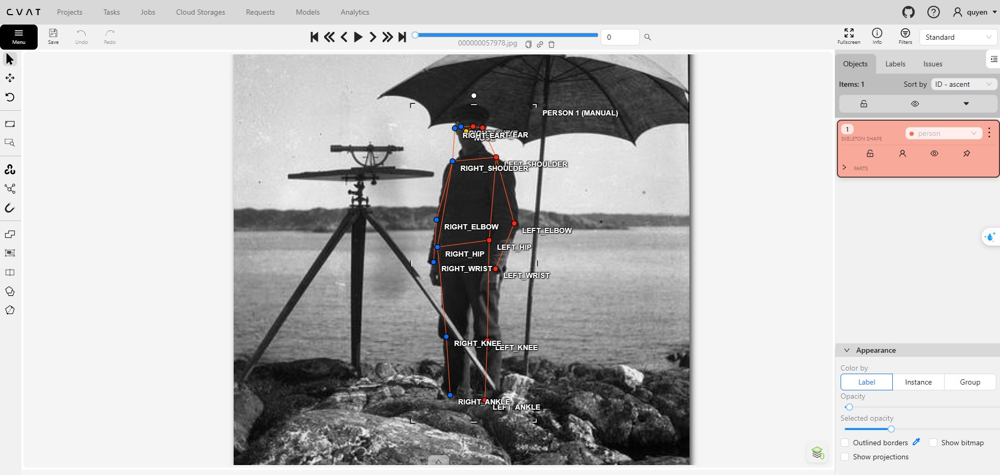
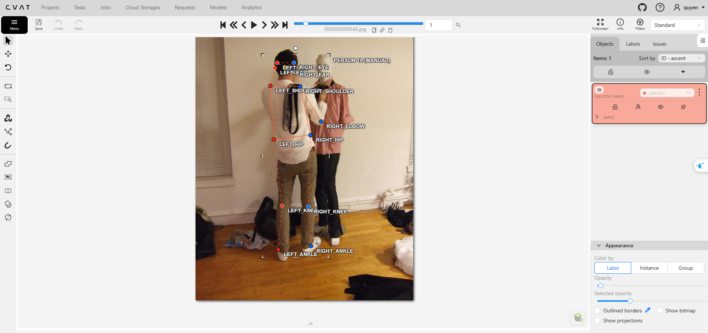
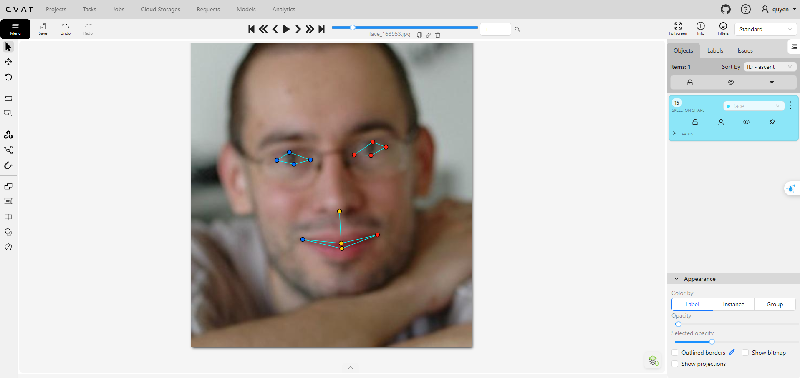
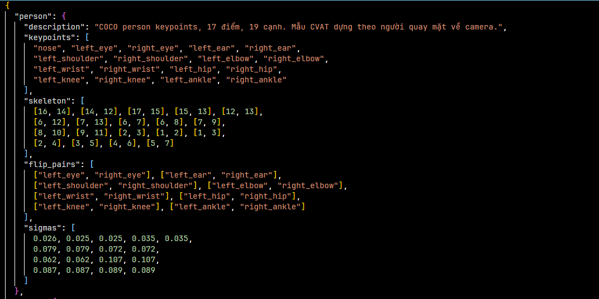

# Báo cáo cá nhân — HoVaTen-MSSV

Đổi tên file theo quy tắc `MSSV_HoTen.md`. Ví dụ: `20241234_NguyenVanAn.md`.

Dữ liệu: 12 ảnh người COCO val2017 (Lin et al., 2014) và 8 ảnh chân dung Wikimedia Commons, chỉ dùng trong lớp.

## 0. Thông tin học viên

- Họ tên: Lương Văn Quyến
- MSSV: 2A202603226
- Email: 26ai.quyenlv@vinuni.edu.vn
- Link repository: https://github.com/VanQuyen11/K5-L2-DAY04-LuongVanQuyen-2A202603226-KeypointPose/tree/main
- Phiên bản CVAT (Help → About): 2.74.1
- Máy: hệ điều hành Windows 11 · RAM 16 GB · chạy CVAT chế độ đầy đủ 
- Bộ ảnh (`src/exports/assignment.json` do `lab.py setup` tạo): có 
- Giờ bắt đầu: 16h00
- Giờ kết thúc: 19h15

## 1. Kiểm tra label (CP0)

| Label | Kiểu | Số điểm | Tên điểm đúng bảng của lab? | Đúng thứ tự? | Số cạnh |
|---|---|---:|---|---|---:|
| `person` |skeleton |17 |Có |Có |19 |
| `face` |skeleton |13 |Có |Có |13 |

Mẫu `person` dựng theo người quay mặt về camera (các điểm `left_*` nằm bên phải khung mẫu)? **Có**

Cách đổi cờ `occluded` / `outside` cho **một điểm** trên phiên bản CVAT này (một câu): rê chuột đúng vào điểm cần đổi, nhấn `Q` để bật hoặc tắt `occluded`, nhấn `O` để bật hoặc tắt `outside`; cũng có thể nhấn chuột phải vào điểm và chọn cờ trong menu.

...

## 2. Số lượng đã gán và thời gian (CP1, CP2)

| Nhóm ảnh | Số ảnh | Số skeleton đã gán | Số người dưới 60 px (không gán) | Số poster / gương / màn hình bỏ qua | Thời gian (phút) |
|---|---:|---:|---:|---:|---:|
| `easy` | 5 |5 |6 |0 |30 |
| `occluded` | 3 |4| |0 |30 |
| `back` | 2 |4 |5 |0 | 30|
| `small` | 1 |2 |0 |0 |30 |
| `crowd` | 1 |3 | |0 |30 |
| `faces` | 8 |8 |  |0 |30 |

- Số ảnh người đã xong ở mốc phút 105: 8 / 10
- Thời gian thực tế (phút): CP1 80 · CP2 30 · CP3 20
- Ảnh tốn thời gian nhất là ảnh nào, vì sao?

Ảnh tốn thời gian nhất là ảnh: 000000091637.jpg
Trong ảnh có 2 đối tượng bị che khuất chéo lên nhau . Các điểm khớp xương (keypoints) của hai người bị chồng lấn, đòi hỏi phải phóng to và quan sát rất kỹ để gán nhãn chính xác tọa độ điểm, tránh tình trạng nối nhầm khớp xương của người này sang ID của người kia."


## 3. Bảng ca khó (CP1, CP2)

Mỗi điểm bạn phân vân một dòng, nhất là phân vân giữa `v = 1` và `v = 0`, hoặc không chắc hướng người.

| Ảnh | Người / mặt | Điểm | Cờ đã chọn | Phân vân giữa | Lý do chọn |
|---|---|---|---:|---|---|
|`000000106051.jpg` |Người bé và quay nghiêng |tai trái |v=0 | |đã bị khuất |
|`face_13874.jpg` |Mặt người đeo kính râm |2 mắt |v=0 | |đã bị che |
|`000000091637.jpg` |Hai người che nhau |mắt cá chân phải |v=0 | |đã bị che khuất |

## 4. Bảng tự review (CP3)

Đi từ ảnh cuối về ảnh đầu. 5 ảnh người (ít nhất 2 ảnh `back` hoặc `crowd`) và 3 ảnh mặt. Ít nhất 8 dòng, kể cả dòng `ok`. Ghi lỗi trước, sửa sau.

## 4. Bảng tự review (CP3)

Đi từ ảnh cuối về ảnh đầu. 5 ảnh người (ít nhất 2 ảnh `back` hoặc `crowd`) và 3 ảnh mặt. Ít nhất 8 dòng, kể cả dòng `ok`. Ghi lỗi trước, sửa sau.

Mã lỗi dùng đúng một trong: `lr_swap`, `vis_flag`, `position`, `missing`, `extra`, `ok`.

| Ảnh | Người / mặt | Điểm | Mã lỗi | Ghi chú | Đã sửa? |
|---|---|---|---|---|---|
| `000000307757.jpg` | Hai người khoác vai nhau (nhóm `back` / `occluded`) | `right_shoulder` | `vis_flag` | Vai bị tay của người kia che khuất nhưng đánh nhầm thành v=2 | Rồi |
| `000000123544.jpg` | Cầu thủ bóng chày | `left_elbow` | `position` | Chấm cùi chỏ bị lệch ra ngoài rìa áo | Rồi |
| `000000463932.jpg` | Công nhân công trường | `left_wrist` | `lr_swap` | Gán nhầm điểm cổ tay trái sang cổ tay phải | Rồi |
| `000000057978.jpg` | Người che ô cạnh tripod | Tất cả | `ok` | Khung xương gán chuẩn, cờ hiển thị chính xác | Không cần |
| `000000196283.jpg` | Người trượt tuyết quay lưng (nhóm `back`) | `right_knee` | `missing` | Bỏ sót chưa chấm điểm đầu gối phải | Rồi |
| `face_13874.jpg` | Mặt nữ đeo kính râm | `right_eye_inner` | `vis_flag` | Mắt bị kính che hoàn toàn nhưng lại đánh v=2 thay vì đoán (v=1) | Rồi |
| `face_264124.jpg` | Mặt nam góc nghiêng gọi điện | `left_eye_outer` | `extra` | Đuôi mắt trái bị khuất hoàn toàn (v=0) nhưng vẫn cố đoán và gán điểm | Rồi |
| `face_168953.jpg` | Mặt nam đeo kính cận | Tất cả | `ok` | 13 điểm trên mặt gán chuẩn xác, liên kết đúng giải phẫu | Không cần |

Tổng hợp số lỗi theo mã:

| `lr_swap` | `vis_flag` | `position` | `missing` | `extra` | `ok` |
|---:|---:|---:|---:|---:|---:|
| 1 | 2 | 1 | 1 | 1 | 2 |

Điểm còn phân vân giữa `v = 1` và `v = 0` (ghi cả hai lựa chọn và lý do chọn):
- Ảnh `000000123544.jpg` (cầu thủ bóng chày đang bắt bóng): Điểm `left_wrist` (cổ tay trái) bị chiếc găng tay bắt bóng to và dày che khuất hoàn toàn. 
- Phân vân: Nên chọn `v = 0` (vì mắt thường không nhìn thấy điểm cổ tay thật nên bỏ qua không gán) hay chọn `v = 1` (vì cổ tay thực chất vẫn nằm trong khung hình, chỉ là đang nằm bên trong găng tay nên có thể đoán được).
- Lý do chọn: Tôi quyết định chọn `v = 1` (bị che khuất nhưng vẫn đoán vị trí) vì dựa vào hướng cẳng tay từ cùi chỏ đi xuống và vị trí của găng tay, tôi hoàn toàn có thể nội suy ra vị trí khớp cổ tay thực tế nằm ở đâu.

## 5. Kiểm file xuất và kết quả tự kiểm (CP4)

Tự kiểm tay trong file JSON:

| File | Người / mặt kiểm (ảnh, thứ tự) | Số phần tử `keypoints` | Điểm `outside` ra `v = 0`, `occluded` ra `v = 1`? | `num_keypoints` khớp? |
|---|---|---:|---|---|
| `LuongVanQuyen_persons.zip` |`000000057978.jpg`, người số 1 |51 |Có |Có, 17 |
| `LuongVanQuyen_persons.zip` |`000000090646.jpg`, người số 1 |51 |Có |Có, 14 |
| `LuongVanQuyen_faces.zip` |`face_13874.jpg`, mặt số 1 |39 |Có |Có, 13 |

Sau khi xuất, CVAT ghi `occluded` thành `v = 1` và `outside` thành `v = 0`. Tọa độ của điểm `outside` trong file là `0, 0` hay tọa độ cũ? Sau khi xuất, CVAT ghi `occluded` thành `v = 1` và `outside` thành `v = 0`. Các điểm `outside` trong file người vẫn giữ tọa độ cũ.

Hai job đã chuyển sang completed trên CVAT? Có

Dán phần **TÓM TẮT** in ra từ `src/check_submission.py`:

- File person: LuongVanQuyen_persons.zip
  Số ảnh: 12 · số skeleton `person`: 18 · mỗi annotation 51 số
  Skeleton theo ảnh: 000000057978=1, 000000090646=1, 000000091637=2, 000000106051=2, 000000123544=2, 000000177889=1, 000000193879=1, 000000196283=1, 000000205650=1, 000000307757=2, 000000326480=3, 000000463932=1
  Cờ v: v=2 211 (69%) · v=1 62 (20%) · v=0 33 (11%)
  num_keypoints trung bình: 15.2
- File face: LuongVanQuyen_faces.zip
  Số ảnh: 8 · số skeleton `face`: 8 · mỗi annotation 39 số
  Skeleton theo ảnh: face_13874=1, face_168953=1, face_264124=1, face_300399=1, face_333134=1, face_442231=1, face_559185=1, face_92028=1
  Cờ v: v=2 91 (88%) · v=1 13 (12%) · v=0 0 (0%)
  num_keypoints trung bình: 13.0
- Ghi chú: 33 điểm v = 0 vẫn mang tọa độ cũ (CVAT 2.x xuất như vậy; chuẩn COCO ghi 0, 0). Không phải lỗi: điểm v = 0 bị bỏ qua khi huấn luyện và khi chấm.
- Số [LỖI]: 0 · số [CẢNH BÁO]: 3


Các `[CẢNH BÁO]` còn giữ nguyên và lý do:

- `000000106051.jpg #1`: cặp tai nằm ngược phía so với các cặp điểm còn lại vì người quay đầu sang một bên. Tôi đã kiểm tra lại hướng đầu và tên `left_ear` / `right_ear`; đây là tư thế thật, không phải lỗi `lr_swap`.
- `000000123544.jpg #1`: cặp đầu gối nằm ngược phía so với phần thân do người đang chạy và hai chân ở tư thế bước chéo. Tôi đã kiểm tra lại từng chân theo người và giữ nguyên nhãn.
- `000000193879.jpg #1`: cặp cổ chân nằm ngược phía so với các cặp còn lại vì hai chân của vận động viên bắt chéo trong lúc di chuyển. Tôi đã kiểm tra từ hông → gối → cổ chân và xác nhận trái/phải đúng.

## 6. Ảnh chụp màn hình

1. Label `person` trong label constructor (đủ 17 điểm có tên):

   

2. Một người quay lưng đã gán, cờ đã đặt:

   

3. Một khuôn mặt đã gán 13 điểm, phóng to vùng mắt:

   

4. Một đoạn JSON xuất của một người:

   

Nguồn ảnh: COCO val2017 / Wikimedia Commons.

## 7. Tự đánh giá

## 7. Tự đánh giá

1. Lỗi bạn mắc nhiều nhất hôm nay, và cách bạn sẽ tránh ở dự án thật:
- Lỗi mắc nhiều nhất: Nhầm lẫn cờ trạng thái hiển thị (`vis_flag`), đặc biệt là phân vân giữa `v = 1` (bị che khuất nhưng đoán được) và `v = 2` (nhìn rõ). Nhiều trường hợp điểm bị lớp kính hoặc trang phục mỏng che khuất nhưng theo thói quen vẫn đánh `v = 2`.
- Cách tránh ở dự án thật: Trước khi chốt cờ trạng thái, bắt buộc phải zoom to (phóng to) ảnh để xác nhận bằng mắt thường xem điểm đó có bị lớp pixel của vật thể khác (tóc, kính, quần áo dày, người khác) đè lên hay không. Nếu có dù chỉ một chút, phải chuyển về `v = 1`. Sẽ tạo thói quen: "Không thấy da/khớp thật = Không dùng v=2".

2. Một quy tắc bạn đề xuất thêm vào guideline (kèm ảnh ví dụ nếu có):


3. Nhãn của bạn đi vào model ở đâu? Chọn một lỗi bạn đã sửa và nói nó sẽ làm model học sai thế nào (heatmap, trọng số trong loss, hay bước lật ảnh):
- Nhãn đi vào model ở đâu: Tọa độ (x, y) của các keypoints sẽ được biến đổi thành các bản đồ nhiệt (Ground Truth Heatmaps - dạng phân bố Gaussian 2D) để dạy model. Cờ hiển thị (v=1, v=2) sẽ đóng vai trò làm cờ kích hoạt (mask/weight) trong hàm Loss (thường là MSE Loss), quyết định việc model có bị phạt hay không khi dự đoán sai điểm đó.
- Lỗi đã sửa: Lỗi gán nhầm tay trái sang tay phải (`lr_swap`) ở ảnh công nhân `000000463932.jpg`.


## 8. Khó khăn và lỗi kỹ thuật

## 8. Khó khăn và lỗi kỹ thuật

**1. Khó khăn trong quá trình gán nhãn (Annotation Difficulties):**
- **Che khuất phức tạp (Occlusion / Crowd):** Trong các ảnh có mật độ người đông (nhóm `crowd`) hoặc các đối tượng tương tác vật lý với nhau (khoác vai, ôm nhau), các chi và khớp xương bị chồng chéo rất nhiều. Việc xác định đúng bộ phận thuộc về ID nào (tránh lỗi nối nhầm chi của người này sang người kia) tốn rất nhiều thời gian phân tích và phải zoom ảnh liên tục.

- **Đối tượng mờ hoặc quá nhỏ (Small):** Các đối tượng ở xa (kích thước nhỏ nhưng vẫn lớn hơn 60px) thường có hiện tượng vỡ điểm ảnh (pixelation). Điều này gây khó khăn trong việc chấm điểm khớp xương một cách chuẩn xác, dễ dẫn đến lỗi sai lệch vị trí (`position`).

**2. Lỗi kỹ thuật và thao tác (Technical & Tool Issues):**
- **Nhầm lẫn phím tắt:** Đôi khi thao tác quá nhanh dẫn đến bấm nhầm phím tắt trên giao diện (ví dụ nhầm phím chuyển đổi trạng thái cờ `Visibility`), làm thay đổi cờ `v` ngoài ý muốn hoặc vô tình click sinh ra điểm thừa (`extra point`) mà không phát hiện ra ngay.
- **Giật/lag giao diện:** Khi xử lý các bức ảnh có chứa quá nhiều bộ khung xương người (ví dụ ảnh đám đông) hoặc khi thao tác bật/tắt liên tục các lớp ID hiển thị, trình duyệt đôi khi gặp hiện tượng khựng (lag) nhẹ, làm giảm tốc độ gán nhãn.

## Bonus (nếu làm)

### B1 — 3 ảnh người khó thêm

| Ảnh | Số skeleton | Số người dưới 60 px | Ca khó nhất |
|---|---:|---:|---|
| | | | |
| | | | |
| | | | |

Kết quả `src/check_submission.py` cho `HoVaTen_bonus_persons.zip`:

```text
(dán ở đây)
```

### B2 — 5 ảnh khuôn mặt đen trắng / hồng ngoại

Ảnh không màu khó hơn ở điểm nào? Kính râm trên ảnh hồng ngoại có còn là `v = 1` không?

...

### B3 — Model so với nhãn của tôi (không tính điểm)

- Demo đã dùng:
- Ảnh đã thử:

1. Model có trả điểm cho khớp bị che, hay khớp ngoài ảnh không? Confidence ở các điểm đó thế nào?

   ...

2. Với người quay lưng, model có đổi trái/phải không?

   ...

3. Bộ điểm của model có giống 17 điểm COCO không?

   ...

## 9. Tài liệu tham khảo và công cụ AI đã dùng

-Tài liệu docs/GUIDELINE.md: quy ước 17 điểm người, 13 điểm khuôn mặt, trái/phải và cờ visibility.
-Tài liệu docs/CVAT_CHEATSHEET.md: thao tác gán skeleton và đổi cờ cho từng điểm trên CVAT.
-Tài liệu docs/COCO_KEYPOINTS.md: cấu trúc mảng keypoints, num_keypoints, ý nghĩa của v = 0, v = 1 và v = 2.
-Lin et al. (2014), Microsoft COCO: Common Objects in Context.
-OpenAI Codex: dùng để kiểm tra cấu trúc hai file ZIP đã xuất, thống kê số skeleton, giải thích định dạng COCO Keypoints và hỗ trợ chỉnh câu chữ cho báo cáo.

